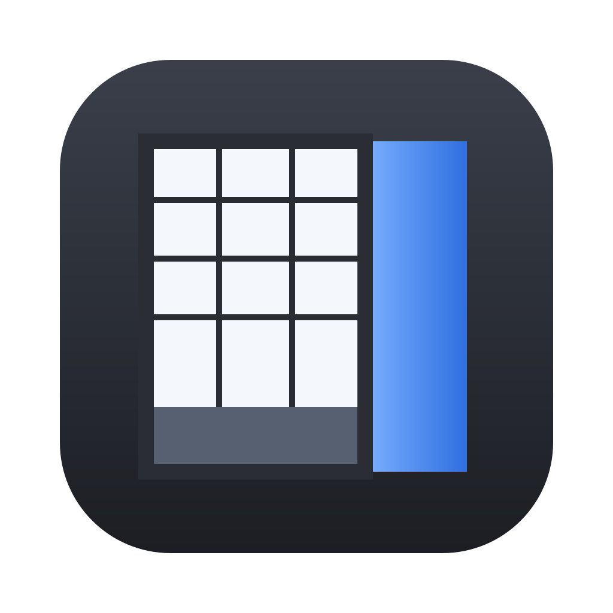
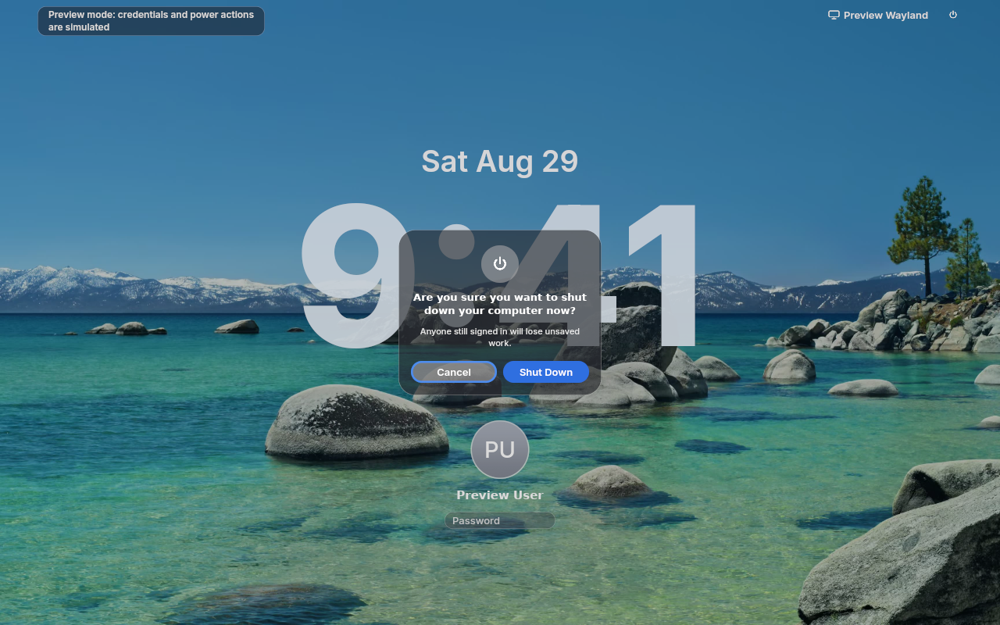

# Genkan

A greetd login screen and session lock that follows macOS.

Genkan is a graphical [greetd](https://sr.ht/~kennylevinsen/greetd/) frontend
for Linux, built with Rust and iced. It runs fullscreen under Cage or niri on
the login VT, while greetd stays responsible for PAM authentication and
starting the selected Wayland session. The same look carries over to
`genkan lock` and an optional desktop wallpaper.

| Account selection | Authentication |
|:--:|:--:|
| [](rfd/0001/reference-images/account-selection.png) | [](rfd/0001/reference-images/secret-prompt.png) |

[](rfd/0001/reference-images/power-confirmation.png)

These are deterministic development-preview captures with synthetic accounts
and sessions.

## Features

- **Login** through greetd, including multi-prompt PAM conversations and
  AccountsService user discovery. Genkan passes validated session arguments
  to greetd without invoking a shell itself; see
  [session launch](docs/architecture.md#session-launch).
- **Power menu** with Sleep, and confirmed Restart and Shut Down, through logind.
- **Session lock** (experimental) on `ext-session-lock-v1` compositors,
  covering every output fail-closed and reporting readiness to idle managers.
- **Wallpapers**: Apple's 156 Tahoe aerial MOVs and dynamic HEICs, downloaded
  explicitly from upstream rather than bundled, with posters, reduced motion,
  and a generated fallback background.
- **Desktop wallpaper** for wlr-layer-shell compositors, with time-of-day and
  optional solar scheduling for HEICs.
- **One design** for login and lock, drawn from shared tokens: the date and
  clock above the avatar, name, and password field, over an undimmed wallpaper.
- **Nix packaging** for x86_64-linux and aarch64-linux, with a NixOS module.

## Install on NixOS

Add Genkan as a flake input, then import its module and enable the greeter:

```nix
{ genkan, ... }:
{
  imports = [ genkan.nixosModules.default ];
  programs.genkan = {
    enable = true;
    greeter.enable = true;
    wallpaper.source.catalog = "macos-landscape-tahoe-day"; # optional
  };
}
```

The module configures greetd, runs the greeter under Cage, and installs the
lock's PAM policy. Enable at least one Wayland desktop session, such as
`programs.niri.enable = true`. The [install guide](docs/install.md) covers the
flake input, monitors, accounts, and prebuilt releases for other Linux hosts
with Nix.

To lock the session, bind `genkan lock --daemonize` to a key or your idle
manager. It returns once the compositor confirms the lock.
This is not a suspend veto; read
[lock on idle and before sleep](docs/lock.md#lock-on-idle-and-before-sleep)
before relying on it at suspend.

## Try the UI

The preview uses synthetic accounts and never sends credentials or power
requests:

```sh
nix develop
make dev                         # login
PREVIEW=power-confirmation make dev
make lock-dev                    # lock
```

Wallpapers are not bundled. `assets preview` downloads one into your cache and
opens it in the same simulated window:

```sh
genkan assets list
genkan assets preview macos-landscape-iceland-snow-caps
```

Select a cached wallpaper with `--wallpaper ID` on `login`, `lock`, or
`wallpaper`. If the NixOS module provisions a system wallpaper, pass the
absolute path printed by `genkan assets download` to `--wallpaper-file`
instead; see [wallpapers](docs/wallpapers.md). For an uninstalled build, use `cargo run --bin genkan -- assets …`
inside `nix develop`.

## Documentation

| Guide | Read it to |
| --- | --- |
| [Install and configure](docs/install.md) | Set up the greeter on NixOS or from a release; choose monitors, accounts, sessions, and power policy |
| [Wallpapers](docs/wallpapers.md) | Download, preview, provision, and run login, lock, and desktop wallpapers |
| [Session lock](docs/lock.md) | Lock on idle and before sleep, and recover from failures |
| [niri](docs/niri.md) | Use niri as the greeter, the session, or the wallpaper and lock host |
| [Development](docs/development.md) | Preview the UI, choose checks, and release |
| [How Genkan works](docs/architecture.md) | Understand the security, session, decoding, and presentation boundaries |
| [Design system](docs/design-system/README.md) | Follow the visual rules and tokens |
| [Requests for Discussion](rfd/README.adoc) | Read the design decisions behind each feature |
| [Deferred work](docs/deferred.md) | See what is intentionally not done yet |

Before completing a code change, run `nix develop --command make verify`. The
[development guide](docs/development.md#choose-the-checks) lists the extra VM
and hardware checks for each kind of change.

## License

Genkan source code is licensed under the [MIT License](LICENSE). Wallpaper
provenance and integrity metadata are recorded separately in
[RFD 2](rfd/0002/README.adoc) and the
[wallpaper manifest](assets/wallpapers/manifest.toml). Those records do not
assert an open-content license for upstream artwork.
